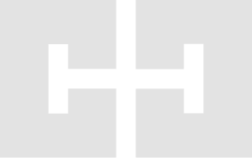

  

<h1 align="center">Carlos Costa</h1>

  <strong>Frontend, Mobile & UI/UX Developer</strong> 
  <em>Building lean interfaces, reusable tools, and digital products with care for design and code.</em>

  
  
  
  
  
  

---

  
  &nbsp;
  
  &nbsp;
  
  &nbsp;
  
  &nbsp;
  
  &nbsp;
  
  &nbsp;
  
  &nbsp;
  
  &nbsp;
  
  &nbsp;
  
  &nbsp;
  
  &nbsp;
  
  &nbsp;
  
  &nbsp;
  

---

### About

Developer and designer from Natal/RN, Brazil. I work with **frontend web**, **Flutter/Android mobile apps**, and **UI/UX**, building interfaces, libraries, and digital products.

### More Projects

- [TMDB SDK](https://github.com/carllosnc/tmdb-sdk)
- [IGDB SDK](https://github.com/carllosnc/igdb-sdk)
- [Discogs SDK](https://github.com/carllosnc/discogs-sdk)
- [Metadata API](https://github.com/carllosnc/metadata-api)
- [Flutter Shared State](https://github.com/carllosnc/flutter_shared_state)
- [Pulse DB](https://github.com/carllosnc/pulse_db)
- [Imgy](https://github.com/carllosnc/imgy)
- [Steps](https://github.com/carllosnc/steps)
- [Reactive Preferences](https://github.com/carllosnc/reactive_preferences)
- [Datacine](https://github.com/carllosnc/datacine)
- [Fabric](https://github.com/carllosnc/fabric)
